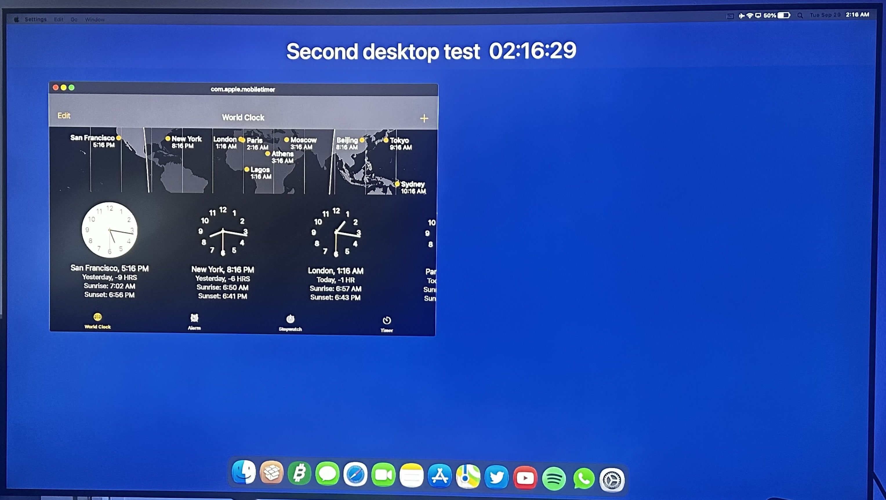

# MacStatusBar&Dock

A macOS-style desktop for jailbroken iPads: a Mac menu bar with real app menus, Mac windows on the window engine you choose, Mission Control with desktops, a Finder and a magnifying Dock. It works with your fingers or with a trackpad or mouse, in every orientation.

| | |
|---|---|
| Device | iPad only. On an iPhone it does nothing, even on one made to look like an iPad. Builds with the iPad check removed are not made or supported by us. |
| iPadOS | 15 to 18. On newer versions it stays off until you turn on Enable Anyway. |
| Jailbreak | Rootless. The test iPads use Dopamine and palera1n. |
| Needs | A hooking platform (ElleKit, libhooker or Substrate), Choicy or iCleaner Pro, and AltList. Sileo installs what's missing. |
| Window engine | Optional: Aerial, Zetsu, MilkyWay4 or Apple's Stage Manager. See [Window engines](#window-engines). |
| License | Free and open source (GPL-3.0-only). |

[Install](#install) · [Features](#features) · [Window engines](#window-engines) · [Compatibility](#compatibility) · [Troubleshooting](#troubleshooting) · [Privacy](#privacy) · [Report a bug](#report-a-bug) · [Settings reference](./docs/settings.md) · [Changelog](./CHANGELOG.md)

## Install

1. In Sileo or Zebra, add this repo. On the iPad you can also open the address in Safari and tap Add to Sileo.

   ```
   https://besiktasliseba.github.io/repo/
   ```

   It's also on [Havoc](https://havoc.app/package/macstatusbardoc), with the same package.

2. Install **MacStatusBar&Dock** and respring when Sileo asks.
3. For windows, add a window engine, or use Apple's Stage Manager on iPadOS 16 to 18. Settings > Windows & Multitasking > Window Engine lists them, with a GET button for each one you don't have yet.

After the respring:

- Apps still open full screen. Tap the green light in the menu bar to put an app in a window, or turn on **Window > Open Apps as Windows** to open every app in one. With the Stage Manager engine, apps open as windows from the start.
- The switches are in Settings > Status Bar, Windows & Multitasking and Dock, right below General (on iPadOS 18, at the top of Settings > General). The [Settings reference](./docs/settings.md) explains each one.
- Desktops and Mission Control stay off until you turn on Settings > Windows & Multitasking > Mac Switcher.

Updates come through Sileo, and the Apple menu shows Update Available when your package list has a newer version. The checksum and source commit of every published package are in [RELEASES.md](https://github.com/BesiktasliSeba/repo/blob/main/RELEASES.md).

## Features

| On a Mac | In MacStatusBar&Dock |
|---|---|
| Menu bar with the Apple menu and app menus | The same, plus Wi-Fi, audio and VPN menus |
| Windows with traffic lights | Mac windows on Aerial, Zetsu, MilkyWay4 or Apple's Stage Manager |
| Mission Control and Spaces | The Mac Switcher, with up to 8 desktops that slide with your fingers |
| Finder and the desktop | A Finder window, and your files on the first Home Screen page |
| Dock | A magnifying Dock with Finder, Launchpad, recent apps, a Downloads stack and a Trash |
| Activity Monitor | An Activity Monitor window with your processes' CPU, memory and disk use, also in the App Library and the Dock |
| Search in System Settings | A search field at the top of the Settings sidebar |

The Mac look is on right after install, and most features have their own switch. Some extras start off, such as the Mac Switcher, the Dock's Trash, the auto-hiding menu bar, seconds in the clock, tinted resize handles, the keyboard extras and the Lock Screen options. The [Settings reference](./docs/settings.md) shows how each switch starts.

### Menu bar

- The Apple menu has About This iPad, App Store, Force Quit, Respring, Safe Mode, Lock Screen, Sleep and Shut Down. The app in front gets App, Edit, Go and Window menus.
- Tap the clock to drop down your Today View widgets, with your notifications above them.
- The Wi-Fi icon opens a Wi-Fi menu, so you can join a network without Control Center. The Audio menu gives each app its own volume, and apps can play at the same time. While a VPN is connected, it gets its own menu with Disconnect.
- Right-to-left languages get a mirrored menu bar, as on a Mac. Status Bar Style switches back to the stock iPadOS bar.
- Menu Bar Size in Settings > Status Bar: Medium and Large make the menu bar taller, with larger text, icons and menus that are easier to tap with a finger.

### Windows

- Title bars, traffic lights, rounded corners and resize handles, on the engine you already use.
- The Window menu has layouts (halves, quarters, Fill Screen, Center) and Fit to Window, which tiles your windows side by side. Layouts and tiles reach the screen's edges, from right under the menu bar down to the Dock.
- A window you move or resize lines up with the screen edges, the menu bar, the Dock and other windows when you let go of it near them.
- On iPads with a Home button, windows placed before 1.7.1 with a gap under the menu bar move up under it once.
- Windows have a smallest size with every engine, as with Stage Manager: the app at least 320 x 300 points.
- With Aerial, Zetsu or MilkyWay4 on iPadOS 15 to 18, every app with a window has its card in iPadOS's App Switcher, as with Stage Manager. A tap on the card brings the window forward.
- Only the window you're using keeps a text cursor, and Esc ends typing.
- With the Stage Manager engine on iPadOS 16 to 18, windows float over your Home Screen and stay where you put them, and on iPadOS 16 an external display gets its own Mac desktop.

### Mac Switcher (Mission Control and Spaces)

Off until you turn it on in Settings > Windows & Multitasking > Mac Switcher. It takes the place of the App Switcher.

- Open it with a swipe up and hold, a double press of the Home button, or Control-Up. Your desktops are at the top, and the windows of the current one below.
- Tap + to add a desktop (up to 8). Switch with a four-finger swipe, a swipe along the bottom edge, three fingers on a trackpad, or Control-Left and Control-Right.
- Drag a window onto another desktop to move it there. To remove a desktop, hold it and tap its remove button; its windows move to the desktop next to it.
- It works with every window engine, and your desktops are still there after a respring. Show App Switcher in the Apple menu opens the iPadOS App Switcher once.

### Finder and the desktop

- A Finder window with a sidebar, list and icon views, Quick Look, Search, Undo and Put Back. Open it from the Dock or the Go menu.
- On My iPad shows the same folders as the Files app, with a folder for each app that shares its files there.
- The Trash has an Empty button at the top right, and emptying the Trash plays a sound unless the iPad is muted.
- Drag files between Finder windows, the desktop and the Downloads stack, or into an app, which gets a copy.
- Files and folders from On My iPad > Desktop sit on the first Home Screen page, never over your apps. A long press or a right click opens their menus over your windows, and Hide Name hides an icon's name (Hide Desktop Icon Names in Settings > Status Bar hides them all).
- Text files open in a small TextEdit window and save by themselves.
- USB drives and SD cards show up under Locations. exFAT and FAT32 work (FAT32 can't hold files over 4 GB). APFS and Mac OS Extended should work but haven't been tested, and iPadOS doesn't read NTFS. An SSD may need a powered hub.
- On iPadOS 16 to 18, each drive has an Eject button in Finder's sidebar, as on a Mac, and File > Eject and the drive's menu eject it too.
- Finder only changes files in your own places: On My iPad, the apps' Documents folders, drives and its Trash. Everything else can be opened and copied, but not changed.

### Dock

- Magnification, dots under open apps, recent apps, and Finder and Launchpad at its start, like on a Mac.
- A Downloads stack with search, which you can drag files into and out of.
- A Trash at its end, which you turn on in Settings > Dock. Drop files on it to move them to the Trash, a Dock app to take it out of the Dock, or a drive to eject it (iPadOS 16 to 18).
- Haptic Touch menus get Force Quit, App Size and Add to Folder on app icons, and a folder's menu lists its apps. Add to Folder moves the app into a Home Screen folder or a new one, as a drag would, also from the App Library.

### Activity Monitor and RAM & CPU

- An Activity Monitor window lists the running processes with their CPU, memory and disk use. Sort by any column, search, pick All, My or System Processes, inspect a process or quit an app. System processes show no figures, and the Energy and Network tabs have no figures per process.
- Activity Monitor is also an app in the App Library, in Utilities and in its search. Add to Dock in its menu puts it in the Dock, where it works like an app. It's never saved with your Home Screen layout. Show in App Library in Settings > Status Bar turns it off.
- RAM & CPU in Control Center shows the available and used memory and the CPU load, and a tap opens the details, with a button for Activity Monitor. Activity Monitor also opens from the Go menu and from Spotlight's actions.
- With Memory Magic on iPadOS 15 to 17, a tap on its tile offers to put RAM & CPU in its place.

### Settings

- The Status Bar, Windows & Multitasking and Dock pages sit right below General and look like Apple's own pages. On iPadOS 18 they are in a group at the top of Settings > General.
- A search field at the top of the Settings sidebar finds Apple's settings, like the search in System Settings on a Mac, and can find your tweaks' settings too.

### Also included

- A Mac pointer, with an I-beam over text
- Mac-style notification banners and a mute icon
- A Go menu with the apps you choose, and an auto-hiding menu bar
- Home Screen options: page dots, app names and the Home Bar
- Keyboard extras for keyboards without a function row
- Spotlight extras you can turn on: tweak settings, actions, your windows, and your Desktop and Downloads files
- Longer Auto-Lock times, up to 2 hours, which the tweak makes iPadOS keep (on its own, iPadOS takes anything over an hour for Never)
- An SSH switch and Ethernet settings
- VoiceOver labels for the menu bar, the traffic lights and Finder, and Reduce Motion support

### Built to be safe

- If SpringBoard crashes twice in a row because of this tweak, Automatic Crash Recovery turns off what crashed, tells you in Settings and offers Report a Problem. A crash in another tweak doesn't count.
- On an iPadOS version it hasn't been tested on, it stays off until you choose Enable Anyway.
- Package managers, the jailbreak apps and Filza never get its app parts, so they keep working and you can always remove it.
- It has no network code. See [Privacy](#privacy).

## Window engines

The menu bar and the Dock work on their own. App windows come from a window engine, and MacStatusBar&Dock gives them the Mac look. Pick one in Settings > Windows & Multitasking > Window Engine. Only that one loads (MacStatusBar&Dock sets up Choicy or iCleaner Pro for you), and a switch takes a respring.

| Engine | iPadOS | Notes |
|---|---|---|
| Stage Manager, by Apple | 16, 17, 18 | Needs Stage Manager on the iPad (TrollPad adds it to older iPads). A new install on iPadOS 16.1 to 18 starts with it where it runs. Up to 7 windows per desktop. The only engine that gives an external display its own desktop (tried on 16). Tested on 16.7.7, 17.5.1 and 18.5. |
| Aerial 5.1, 5.0 or 3.0, by uz.ra | 15, 16 (17 and 18: 5.1) | Aerial 5.0 and 5.1 have to be activated in their own settings before they open windows. |
| Zetsu 1.6.6 or 1.6.2, by Dcsyhi | 15, 16 (17 and 18: 1.6.6) | A good alternative. Desktops were tested with 1.6.6. |
| MilkyWay4 0.1.1, by akusio | 15 | Adds the Resize Apps to Fit Windows switch. |

Other versions of these engines run on their own, without the Mac look, and Settings marks them "untested version".

Which one? On an iPad with Stage Manager (or TrollPad) on iPadOS 16.1 to 18, a new install starts with Stage Manager, Apple's own windowing. Anywhere else, start with Aerial. Updating keeps the engine you picked, so if you already use Aerial or Zetsu, nothing changes.

## Compatibility

| iPad | iPadOS | Jailbreak | Engines tested | Status |
|---|---|---|---|---|
| iPad Pro 11" (M1, 2021) | 15.6.1 | Dopamine | Aerial 5.0 and 5.1, Zetsu, MilkyWay4 | Tested by the developer |
| iPad Pro 9.7" | 16.7.7 | palera1n | Aerial 5.0 and 5.1, Zetsu, Stage Manager (with TrollPad) | Tested by the developer |
| iPad Pro 12.9" (2nd generation) | 17.5.1 | palera1n | Stage Manager (with TrollPad), Aerial 5.1, Zetsu 1.6.6 | Tested by the developer |
| iPad Pro 12.9" (4th generation) | 18.5 | Dopamine | Stage Manager (the iPad's own), Aerial 5.1, Zetsu 1.6.6 | Tested by the developer |
| iPad Pro 10.5" | 16.6.1 | rootless | not reported | Reported working by a user |
| iPad mini 4 | 15.8.8 | rootless | not reported | Reported running by a user |
| iPad Pro (M2, 2022) | 16.0 to 16.6 | Dopamine | Zetsu, Aerial | Reported by users with Zetsu or Aerial. Stage Manager engine: see below |
| iPad Pro 12.9" (M1, 2021) | 17.0 | rootless | Zetsu 1.6.6 | Reported working since 1.2.4 |
| iPad Pro 12.9" (M1, 2021) | 16.1.1 | Dopamine | Stage Manager, Zetsu | Reported by a user |
| Other iPads | 15 to 18 | rootless | | Likely to work, not tested |
| Other iPads | Newer than 18 | | | Off until you turn on Enable Anyway, at your own risk |

- iPad Pro (M2) with the Stage Manager engine: offered on 16.1 and later, and as "Untested" on 16.0, where a user confirmed the basics (windows, resizing, traffic lights). On 16.3.1 a user confirmed it runs.
- iPadOS 17: tested on 17.5.1 with the Stage Manager engine (Stage Manager through TrollPad), Aerial 5.1 and Zetsu, together with the desktop, Finder, the Wi-Fi menu, the Mac Switcher and the Spotlight extras. The Home Screen options are on the Dock page in Settings there. iPads with Stage Manager of their own on 17 and external displays on 17 haven't been tried yet; reports are welcome.
- iPadOS 18: tested on 18.5 with the Stage Manager engine (an iPad with Stage Manager of its own), Aerial 5.1 and Zetsu, together with the desktop, Finder, the Wi-Fi menu, the Mac Switcher and RAM & CPU. Settings has no room for tweak rows in its sidebar there, so the tweak's pages and rows are in a group at the top of Settings > General. The tweak's search field in the Settings sidebar is for iPadOS 15 to 17. External displays on 18 haven't been tried yet.

Tried it on another setup? A [compatibility report](https://github.com/BesiktasliSeba/MacStatusBarAndDock/issues/new?template=compatibility.yml) (works or doesn't) helps fill in this table.

## Known limitations

- The tweak's own menus and Settings pages are in English only.
- Apple's Stage Manager stays off while another window engine runs, because two window systems would fight over the same apps. To use it, pick Stage Manager as the engine.
- With the Stage Manager engine, a desktop holds up to 7 windows.
- Some apps, like many games, only run full screen. The camera works only full screen (iPadOS pauses it in a window), and Photos opened from the Camera stays full screen.
- External displays: on iPadOS 15 the iPad is mirrored. On iPadOS 16 with engines other than Stage Manager, windows stay on the iPad; open apps from the display's App Library to use them there.
- Finder can't show iCloud Drive (iPadOS doesn't allow it), drag and drop goes from Finder into apps but not back yet, and drives have been tested on iPadOS 15 only.
- On iPadOS 15, Safari's sound can stop another app that plays alone, as on a stock iPad. Control Center's Now Playing shows one app at a time.
- While Destra is on, it shows the notification banners instead.

## Troubleshooting

| Problem | What to do |
|---|---|
| Apps open full screen | Turn on Window > Open Apps as Windows, or tap the green light. Aerial 5.0 and 5.1 have to be activated in their own settings first. If Window Engine says None, no tested engine is installed. |
| No desktops or Mission Control | Turn on Settings > Windows & Multitasking > Mac Switcher. |
| Stage Manager is greyed out | The footer under Settings > Windows & Multitasking > Window Engine says why: no Stage Manager on this iPad (TrollPad adds it), an iPadOS version that isn't supported yet, or a respring needed to check. |
| A feature turned itself off | Automatic Crash Recovery turned it off after crashes. Settings > Status Bar says what and why. Tap Turn Back On to try again, or Report a Problem. |
| SpringBoard keeps crashing | Your jailbreak's Safe Mode starts by itself after quick crashes. Exit Safe Mode, and at the next start crash recovery turns off what crashed. The Apple menu also has Safe Mode. |
| Black screen after a respring, with Aerial 5.0 or 5.1 | Aerial 5.0 and 5.1 go online while SpringBoard starts, and with a VPN on (or just turned off) it can hang. Restart the iPad and jailbreak again. Next time, don't respring while a VPN is on or was just turned off; MacStatusBar&Dock warns before resprings that go through iOS. |
| The Status Bar and Dock pages are gone | Both MacStatusBar and MacDock were turned off. Turn them back on in Choicy (or iCleaner Pro), then respring. |
| Several window engines installed | That's fine. Only the one picked in Window Engine loads. Leave the engines' entries in Choicy alone: MacStatusBar&Dock manages them. |

To uninstall, remove MacStatusBar&Dock in Sileo. It gives the window engines their own settings back, undoes its Choicy or iCleaner Pro changes, and sets an Auto-Lock of 2 hours to 1 hour, the longest iPadOS keeps on its own. Finder's Trash isn't visible in the Files app and stays behind, so empty it in Finder first.

## Privacy

MacStatusBar&Dock has no network code. It doesn't contact any server, send analytics or crash reports, or update itself. Report a Problem opens a new GitHub issue in your browser with the report filled in. The report is part of the link, so GitHub receives it when the page opens, and it only becomes an issue if you submit it. About This iPad shows your serial number on screen only. Details, and how to check this in the source: [SECURITY.md](./SECURITY.md).

Window engines are separate tweaks with their own behaviour. For example, Aerial 5.0 goes online when SpringBoard starts.

## Report a bug

The easiest way is on the iPad: Settings > Status Bar > Report a Problem. It opens a new GitHub issue with your iPad model, iPadOS version, window engine and tweak version filled in, plus a short crash summary when crash recovery acted in the last 7 days. You see the whole text first and can change any of it.

You can also [open an issue](https://github.com/BesiktasliSeba/MacStatusBarAndDock/issues/new/choose) from a computer. The form asks for the same details, the steps, and a screenshot or screen recording if you have one.

Please report security problems privately, as described in [SECURITY.md](./SECURITY.md).

## Memory and older iPads

Measured on 1.1.9, before Finder, the desktop and the Mac Switcher were added: over a 30 minute check, SpringBoard used 63 to 69 MB on the 2 GB iPad Pro 9.7" with the Stage Manager engine, and about 100 MB on the M1 iPad Pro. Picture caches have size limits and are emptied when memory runs low, and the Mac Switcher lets go of its desktop pictures then too.

On iPads with 2 or 3 GB of memory:

- Work with 2 or 3 windows at a time. Every window is a running app, and iPadOS closes apps in the background when memory runs short, so they reload when you go back.
- Turn off what you don't use, such as Siri Suggestions (Settings > Siri & Search) and Handoff (Settings > General > AirPlay & Handoff).

## In the works

A real second desktop on external displays for iPadOS 15. An early version already runs its own menu bar, Dock and apps on a TV.



## Contributing

Bug reports and pull requests are welcome. Please read [CONTRIBUTING.md](./CONTRIBUTING.md) before your first pull request: contributions are accepted under a short contributor agreement. How the parts fit together, and how to build and test: [docs/development.md](./docs/development.md).

## License

Copyright (C) 2026 besiktasliseba

SPDX-License-Identifier: GPL-3.0-only

MacStatusBar&Dock is free software under the GNU General Public License, version 3 only. See [LICENSE](./LICENSE) for the full text.

## Credits

MacStatusBar&Dock gives a Mac look to windows from these engines. Thanks to their developers:

- **Aerial** by uz.ra
- **MilkyWay4** by akusio
- **Zetsu** by Dcsyhi

And thanks to these tweaks for setting the bar:

- **Arrow, Finally.** by Andy Ching, for the Mac pointer
- **Lynx 2** by MTAC
- **Single Mute** by 82Flex, for the mute icon

This tweak does not include or modify any of their files.
